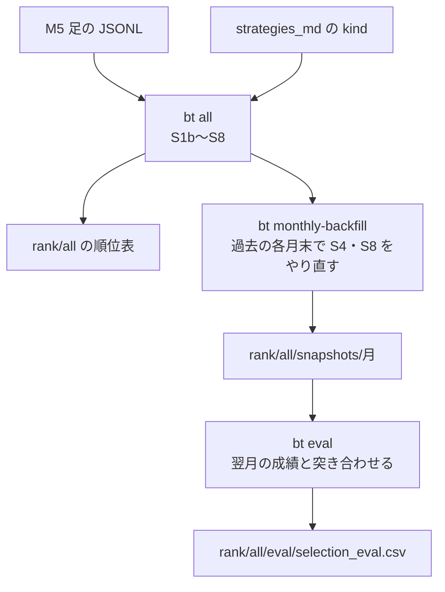
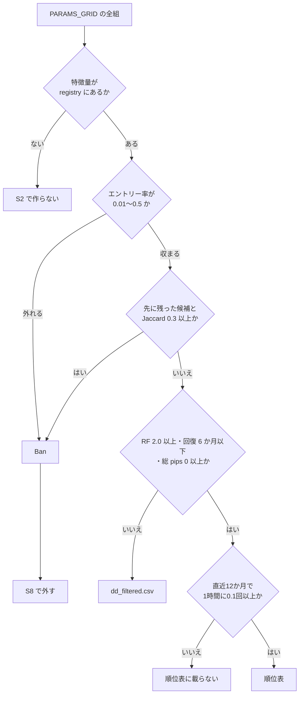

# drip-sim の全体像

このリポを初めて読む人に向けた地図である。何を入れて何が出るか、各段が何を判断するか、戦略候補がどの基準で残り、どこで落ちるかを書く。
Python・pandas と、FX のバックテストの基本（pips・TP/SL）は知っている前提で省く。コマンドの一覧は [README](../README.md)、
判断の理由は [design-decisions.md](design-decisions.md)、戦略の書き方は [strategies_md/HOWTO.md](../strategies_md/HOWTO.md) にある。

## 一言でいうと

M5 足の価格データと、条件を書いた戦略の雛形（kind）を受け取る。kind のパラメータを総当たりで展開して多数の戦略候補を作り、
全候補を同じデータでバックテストして、似た候補と成績の不安定な候補を落とし、残りを順位表にする。

答えは1本の勝ち戦略ではなく、その時点の順位表である。データや kind を足すたびに作り直し、過去の各月末の時点で作った順位表が
翌月に当たっていたかも測れる。

## 使い方の流れ

1. 価格データを `$DRIP_SIM_DATA/bt_data/*_m5_*.jsonl` に置く。形式と取得元は [docs/fetch-data.md](fetch-data.md) にある
2. `strategies_md/<category>/<kind>/` に kind を置く。リポにはダミーの `oscillator/rsi_zone` だけがある
3. `bt all` で S1b〜S8 を順に流し、`rank/all/` の順位表を読む

各段は `bt <段>` で1つずつ流せる。引数は段ごとに違い、`bt all` は引数を受け取らないので、既定値を変えるときは環境変数を使うか段を1つずつ流す。

## データの置き場

すべて `$DRIP_SIM_DATA`（既定は `~/drip_sim_data`）の下に置く。リポの中に出力は書かない。

| パス | 書く段 | 中身 |
|---|---|---|
| `bt_data/*_m5_*.jsonl` | 利用者 | 1行1バーの価格 |
| `parquet_data/year=YYYY/MM.parquet` | S1b・S1c | 月ごとの価格と特徴量の列 |
| `strategies/<kind>/<slug>.py` | S2 | パラメータを1組に固めた戦略ファイル |
| `positions/<kind>/<slug>/year=YYYY/MM.parquet` | S3 | エントリーが立ったバー |
| `ban/` | S4 | 落とす候補の YAML |
| `pos_events/<kind>/<slug>/year=YYYY/MM.parquet` | S5・S6 | 建てた・閉じたイベントと pips |
| `summary/all/YYYY/` | S7 | 候補ごとの月次・四半期・年次の集計 CSV |
| `rank/all/` | S8 | 順位表と、DD で落とした候補の一覧 |
| `rank/all/history/<時刻>/` | `bt.py` | `bt s8` が成功するたびに写す順位表の控え |
| `rank/all/snapshots/YYYY-MM/` | S8（as-of） | その月末時点の順位表 |
| `monthly/YYYY-MM/ALL/` | 月次シム | スナップショットの候補を翌月に日ごとに回した成績 |
| `rank/all/eval/` | eval | 選抜の当たり具合 |

## 各段が決めること

| 段 | 入力 → 出力 | 決めること |
|---|---|---|
| S1b | JSONL → parquet | 時刻で並べ、同じ時刻の重複は後の行を残し、月ごとに分ける |
| S1c | parquet → parquet | `import/feature_registry.yaml` の `precompute` にある特徴量（RSI・EMA・ATR など）のうち、欠けている列だけを `lib/features.py` の `compute_all` で計算して足す。`compute_all` が計算しない列が registry にあれば失敗する |
| S2 | kind → 戦略ファイル | `PARAMS_GRID` の直積を1組ずつファイルにする。必要な特徴量が `import/feature_registry.yaml` に無い組は作らない |
| S3 | 戦略 × 月 → エントリー | 戦略の `apply_entry_flag` を当て、エントリーが立ったバーのうち、分が30の倍数のバーだけを残す |
| S4 | エントリー → Ban | エントリー率が極端な候補と、ほかの候補とエントリーの時刻がよく重なる候補を落とす |
| S5 | エントリー + 価格 → イベント | 次のバーの始値で建て、TP・SL・EOD などで閉じる |
| S6 | イベント → pips | 閉じたイベントごとに、スプレッドを引いた pips を付ける |
| S7 | pips → 集計 | 候補 × 月のエントリー数・pips の合計・二乗和を出す |
| S8 | 集計 → 順位表 | Ban と DD の基準で落とし、残りを直近の成績で並べる |

### S5 の建て方と閉じ方

- S3 が立てたエントリーは次のバーの始値で建てる。立ったバーの値で建てないのは先読みを避けるためである
- 建てられるのは 00:00〜17:00 UTC のバーで、同じ向きは同時に3本まで（`--max-entries`）
- 逆向きのエントリーが来たら、新しく建てずに逆向きのポジションを1本その始値で閉じる（`NET`）
- TP は既定 30 pips、SL は既定 10 pips（`--tp-pips`・`--sl-pips`）。同じバーで両方に届いたら SL として扱う
- 値幅が 30 pips 以上のバーでは、すべてを終値で閉じ（`SPARK`）、そのバーを含めて3本のバーでは建てない
- 17:00 UTC のバーで残りをすべて終値で閉じる（`EOD`）

S6 は閉じたイベントの pips を、閉じた価格と建てた価格の差から出し、スプレッド（既定 0.3 pips）を引く。TP・SL で閉じたイベントには
S5 が TP・SL の価格を閉じた価格として入れるので、TP・SL の値は S5 にだけ渡せばよい。

## 候補が残る基準

図の数値はすべて既定値で、各段の引数で変えられる。

- **エントリー率（S4）**：直近3か月（`--months`）のエントリー数を、00:00〜17:00 UTC のバー数で割る
- **Jaccard 重複（S4）**：エントリー率を通った候補を名前の順に見て、先に残した候補とのエントリー時刻の Jaccard 係数（重なり ÷ 和）が
  0.3 以上なら後の方を落とす
- **Ban の適用（S8）**：S4 は落とす候補を YAML に書くだけで、外すのは S8 である。S3 は既定では Ban を見ずに全候補を計算する
- **DD の基準（S8）**：候補の月ごとの pips を全期間で累積し、最大ドローダウン（abs_dd）を取る。Recovery Factor は総 pips ÷ abs_dd、
  回復月数は abs_dd ÷ 利益の出た月の平均 pips である
- **シグナル頻度（S8）**：直近12か月（`--rank-months`）のエントリー数を時間あたりに直す。M5 足は1時間が12バーなので、バー数 ÷ 12 が時間数である

順位表は同じ候補を3通りに並べる。

| ファイル | 並べる値 |
|---|---|
| `rank_by_pips_avg.csv` | 直近12か月の、1エントリーあたりの平均 pips |
| `rank_by_pips_sum.csv` | 直近12か月の pips の合計 |
| `rank_by_tstat.csv` | 1エントリーあたり pips の t値（平均 ÷ 標準誤差） |

DD の基準は全期間、順位は直近12か月で測るので、長く安定していて、いまも稼いでいる候補が上に来る。

## 選抜が当たっているかを確かめる

`bt all` の順位表は手元のデータ全体を見て作る。過去のある時点でこの選抜を使っていたらどうだったかは、`bt monthly-backfill` と `bt eval` で測る。

`bt monthly-backfill` は前月から遡って12か月（`--months`）の月末 M ごとに次を流す。

1. `s4 --as-of M`：M 以前の月だけで Ban を作り、`ban/asof/M/` に書く
2. `s8` を `S8_AS_OF=M` で流す：M 以前の月だけで DD の基準と順位を計算し、`rank/all/snapshots/M/` に書く
3. 月次シム（`bt monthly`）：M のスナップショットのうち平均 pips が 0.3 以上の候補を、M+1 の平日ごとに回して `monthly/` に書く

`bt eval` は各スナップショットの順位表で選ばれた候補が M+1 にどれだけ稼いだかを、S7 の月次集計で測る。比べる相手は、
M 以前の月次集計に一度でも出た全候補である。1行がスナップショットの月 × 順位ファイルで、主な列は次のとおりである。

| 列 | 意味 |
|---|---|
| `sel_minus_univ` | 選んだ候補の翌月の平均 pips − 全候補の翌月の平均 pips |
| `topk_hit_rate` | 上位 K 件（`--top`、既定10）のうち、翌月にプラスだった割合 |
| `rank_corr` | 順位と翌月の pips の順位相関。当たっていれば正 |

`sel_minus_univ` がプラスの月が多く、`rank_corr` が正なら、選抜は翌月の成績を当てている。

`bt eval` が使うのは S7 の月次集計で、月次シムの出力（`monthly/`）は使わない。月次シムは S3〜S6 と同じ関数で計算する。
S1c が特徴量を焼き込んだ月の parquet に戦略を当て、S3 と同じく30分ごとに絞り、S5 で建てて閉じ、S6 で pips を出して、閉じた日ごとに数える。
そのため同じ候補・同じ日・同じ引数なら、エントリー件数と pips の合計は S3〜S6 の結果と一致する。

## 全体に効く決まり

- **先を見ない**：特徴量は時点 t 以前のデータだけで計算し、エントリーは次のバーで建てる。backfill の Ban と順位も、その月末までの月だけで作る
- **S3・S5・S6 は引数を変えると計算し直す**：出力を作ったときの引数を出力の parquet に残し、次に流したときに今回の値と比べる。
  比べるのは、S3 が `--entry-interval`、S5 が売買の引数（PIP_SIZE・TP・SL・ロット・同時保有上限・急変動の幅とブロック本数・EOD 時刻）、
  S6 が PIP_SIZE とスプレッドである。引数が同じで出力が入力より新しければ飛ばす。引数を残していない出力は計算し直す
- **月次シムの日次 CSV と S8 の as-of スナップショットは作り直さない**：すでにあれば引数に関わらず飛ばすので、引数を変えたら `monthly/` や
  `rank/all/snapshots/` の該当する月を消してから流す
- **サンプルの数値は毎回変わる**：`examples/sample/` の合成データは開始日を実行日から逆算するので、生成するたびに日付と数値が変わる
